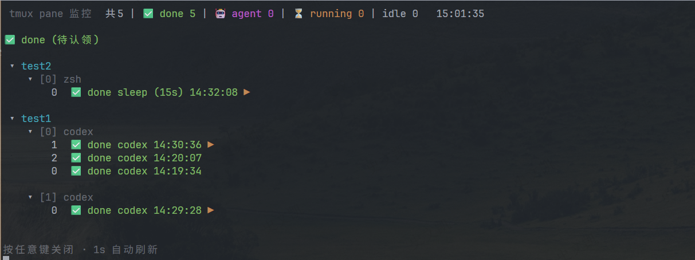

# tmux-pane-notify

在 tmux 中集中感知命令和 AI agent 的完成状态：pane 边框显示状态，`prefix+t`
展示跨 session、window、pane 的全局监控面板。

目前 **Codex 已完成自动集成**：一轮回答结束后面板进入 `✅ done`，提交下一轮问题后
恢复为 `🤖 agent`。opencode、Claude Code 等 agent 当前主要支持进程识别，详细差异见
[Agent 支持](#agent-支持)。



*示例：同一 tmux server 下 2 个 session、3 个 window、5 个 pane 的 Codex/shell 完成状态。*

## 功能

- **pane 级状态**：显示空闲、`⏳ running`、`✅ done`，并支持后台 window 的 `!` 标记。
- **全局监控面板**：tmux 3.2+ 使用 `prefix+t`，按 done、agent、running、idle 分区展示。
- **普通命令提醒**：命令耗时达到阈值后发送 BEL，并在 pane 标题和面板中标记完成。
- **Codex 回合级提醒**：通过 hooks 捕获一轮回答结束，不依赖 `codex` 进程退出。
- **多 pane 独立状态**：同一 window 内运行多个 Codex 时，各自保存完成时间和状态。
- **安全升级**：标记块幂等重写，首次安装备份配置，卸载只移除本工具管理的部分。

## Agent 支持

| Agent / 场景 | 运行状态识别 | 回合级 `✅ done` | 当前接入方式 |
|---|---|---|---|
| Codex | ✅ | ✅ 自动 | 安装器配置用户级 hooks、状态文件和 watcher |
| opencode | ✅ | 需手动集成 | 参考 [opencode 集成](doc/agent-notify/opencode.md) 配置插件 |
| Claude Code | ✅ | 未内置 | hook 方案仍待完善，见 [Claude Code 文档](doc/agent-notify/claude-code.md) |
| Gemini CLI / Aider / Crush / Droid | ✅ | 未内置 | 仅按 pane 前台命令识别为 agent |
| 普通 shell 命令 | ✅ | ✅ | zsh preexec/precmd + 耗时阈值 |

默认识别命令：

```text
opencode claude codex gemini aider crush droid
```

可用 `TPN_AGENT_CMDS` 扩展。未集成回合事件的 agent 只会在运行期间显示为
`🤖 agent`，退出后才会由 shell 命令边界产生提醒。

## Codex 一键部署

### 前置条件

- zsh
- tmux 3.0a+；全局面板需要 tmux 3.2+
- 支持 lifecycle hooks 的 Codex

### 安装

在仓库目录执行：

```bash
bash tmuxSetting.sh
```

安装器会：

- 配置 tmux pane 边框和 `prefix+t` 面板。
- 安装 zsh 命令完成 hook。
- 配置 Codex 的 `UserPromptSubmit`、`Stop`、`Interrupt` hooks。
- 为 tmux 内的 Codex 启动 pane watcher。
- 首次安装时备份现有配置为 `.tpn.bak`。

### 启用

1. 在需要使用的 tmux pane 中重新加载 zsh：

   ```bash
   exec zsh
   ```

2. 重启 Codex，并在首次提示时进入 `/hooks`，信任：

   ```text
   UserPromptSubmit
   Stop
   Interrupt
   ```

3. 在 tmux 中直接启动：

   ```bash
   codex
   ```

   tmux 内的 shell 会自动为 Codex 添加 `--no-daemon`，确保 hooks 能关联到具体 pane。
   请勿使用 `command codex`、`/path/to/codex` 等方式绕过该包装。

4. 关闭旧面板后按 `prefix+t` 重新打开。

### 预期效果

- Codex 回答期间：对应 pane 位于 `🤖 agent`。
- 一轮回答结束：进入 `✅ done`，显示 `✅ done codex HH:MM:SS`。
- 提交下一条问题：该 pane 自动回到 agent 状态。
- 多个 Codex pane：各自维护 done 时间，不互相覆盖。

## 多 Session / Window / Pane

`prefix+t` 会枚举当前 tmux server 中的全部 pane，并以
`session → window → pane` 树状展示。只要 Codex 在同一个 tmux server 内启动，多
session、多 window、多 pane 均会汇总到同一面板。

- 不同 tmux server/socket（例如不同的 `tmux -L` / `tmux -S`）不会汇总。
- `!` 是 window 级标记；具体是哪个 pane 完成，以面板中的 pane 行和边框状态为准。
- 升级后，已有 shell 需要执行一次 `exec zsh`，新开的 pane 会自动加载新配置。

## 其他 Agent

README 只展开 Codex 的自动部署；其他 agent 的完成信号不同，需要分别接入：

- [Agent 接入总览](doc/agent-notify/README.md)
- [opencode](doc/agent-notify/opencode.md)：原生 attention、opencode-bell 或自写插件。
- [Claude Code](doc/agent-notify/claude-code.md)：计划通过 `Stop` / `Notification` hooks 接入。
- [Codex 详细说明](doc/agent-notify/codex.md)：部署、多 pane 验证和故障排查。

## 升级与卸载

重复执行安装命令即可升级：

```bash
bash tmuxSetting.sh
```

卸载：

```bash
bash tmuxSetting.sh --uninstall
```

卸载会移除本工具的标记块、Codex hooks、watcher、pane 状态和运行目录，但会保留
`.tpn.bak` 备份，也不会自动回滚仓库源码。已有 zsh 和 Codex 进程需重新加载或重启。

## 故障排查

- 面板没有 done：确认当前 shell 已执行 `exec zsh`，Codex 已重启，并使用普通 `codex` 启动。
- 面板未刷新：关闭旧弹窗后重新按 `prefix+t`。
- Hook 未生效：在 Codex 中打开 `/hooks`，确认三个 hook 均为 Installed、Active、Trusted。
- 查看状态文件：`/tmp/tmux-pane-notify-<uid>/`。
- 查看 hook 错误：`/tmp/tmux-pane-notify-<uid>/hook.log`。

## 文档

- [tmux 快捷键速查](doc/tmux-cheatsheet.md)
- [AI Agent 完成提醒总览](doc/agent-notify/README.md)
- [Codex 集成说明](doc/agent-notify/codex.md)
